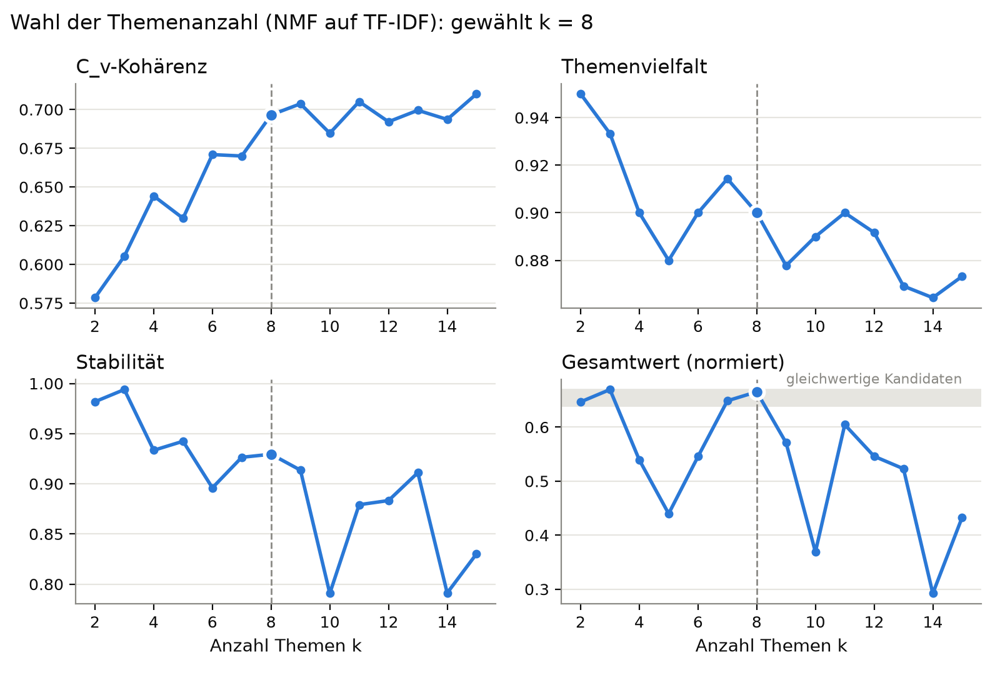

# NLP-Analyse von Verbraucherbeschwerden (CFPB)

Themenextraktion aus Beschwerdetexten mit TF-IDF, CountVectorizer, NMF und LDA.

**Autor:** Niklas Lazar (Matrikelnummer: IU14136580)
**Kurs:** Projekt: Data Analysis (DLBDSEDA02_D), IU Internationale Hochschule

## Daten

Verwendet wird `project_data/complaints_processed.csv` aus dem Repository
[halpert3/complaint-content-classification-nlp](https://github.com/halpert3/complaint-content-classification-nlp)
(ca. 162.000 englischsprachige Beschwerden aus der CFPB Consumer Complaint Database, Spalten `product` und `narrative`).

Die Datei ist ca. 100 MB groß und deshalb nicht in diesem Repository enthalten.
Herunterladen und in den Projektordner legen:

```
git clone --depth 1 https://github.com/halpert3/complaint-content-classification-nlp.git
copy complaint-content-classification-nlp\project_data\complaints_processed.csv .     (Windows)
cp complaint-content-classification-nlp/project_data/complaints_processed.csv .        (macOS/Linux)
```

Alternativ auf der GitHub-Seite die Datei `project_data/complaints_processed.csv` öffnen und über „Download raw file“ speichern.

## Installation

**Python 3.12 oder 3.13** (beide getestet). Neuere Versionen (3.14+) funktionieren noch nicht, weil die Bibliothek gensim dafür keine fertigen Pakete anbietet; ältere Versionen werden von scipy 1.18 nicht unterstützt.
Download: https://www.python.org/downloads/ (z. B. Python 3.13)

**Windows**
```
python -m venv venv
venv\Scripts\activate
pip install -r requirements.txt
```

**macOS / Linux**
```
python3 -m venv venv
source venv/bin/activate
pip install -r requirements.txt
```

Beim ersten Start lädt das Skript die NLTK-Stoppwortliste automatisch herunter (Internetverbindung nötig).

## Nutzung

```
python nlp_analysis.py
```

Optionale Parameter:

| Parameter | Standard | Bedeutung |
|---|---|---|
| `--data` | `complaints_processed.csv` | Pfad zur CSV-Datei |
| `--sample` | `20000` | Größe der Zufallsstichprobe |
| `--k` | automatisch | Feste Themenanzahl; ohne Angabe wird k systematisch bestimmt (siehe unten) |

Beispiel: `python nlp_analysis.py --sample 50000 --k 8`

Laufzeit mit den Standardwerten: ca. 4–5 Minuten (davon der Großteil für die Wahl von k).
Mit fester Themenanzahl (`--k 8`) entfällt die k-Auswahl und das Skript läuft in ca. 1 Minute.

## Ablauf

1. Daten laden, leere Texte entfernen, Zufallsstichprobe ziehen (`random_state=42`)
2. Bereinigung: Kleinbuchstaben, CFPB-Platzhalter „XXXX“, Zahlen, Sonderzeichen und englische Stoppwörter entfernen
3. Vektorisierung mit TF-IDF und CountVectorizer (gleiche Parameter: 5.000 Merkmale, Uni- und Bigramme)
4. Wahl der Themenanzahl k (siehe unten)
5. Themenmodelle mit dem gewählten k: NMF auf TF-IDF, NMF auf Count, LDA auf Count
6. Themenanteile: Anteil der Dokumente, deren dominantes Thema das jeweilige Thema ist
7. Vergleich der Vektorisierungen über die Überschneidung der Top-Wörter (Jaccard)
8. Bewertung der Hauptmodelle mit C_v- und UMass-Kohärenz

### Wahl der Themenanzahl

Für NMF auf TF-IDF werden k = 2 bis 15 getestet und nach drei Kriterien bewertet:

- **C_v-Kohärenz** (Röder et al., 2015): Wie gut passen die Top-Wörter eines Themas inhaltlich zusammen?
- **Themenvielfalt** (Dieng et al., 2020): Anteil verschiedener Wörter unter den Top-Wörtern aller Themen
- **Stabilität** (Greene et al., 2014): Übereinstimmung der Themen auf 10 zufälligen Teilstichproben (je 80 % der Dokumente)

Die Kriterien werden auf 0–1 normiert und gemittelt. Alle k, deren Gesamtwert höchstens 0,03 unter dem besten liegt,
gelten als gleichwertig; unter ihnen wird das k mit der höchsten C_v-Kohärenz gewählt.
Im Standardlauf sind k = 2, 3, 7 und 8 gleichwertig, gewählt wird **k = 8**.



## Ausgabe

Konsolenausgabe mit Top-Wörtern und Anteilen je Thema sowie CSV-Dateien im Ordner `results/`:

| Datei | Inhalt |
|---|---|
| `top_words_nmf_tfidf.csv`, `top_words_nmf_count.csv`, `top_words_lda_count.csv` | Top-10-Wörter und Anteil je Thema |
| `topic_shares_*.csv` | Themenanteile in % |
| `vectorizer_comparison.csv` | Zuordnung und Überschneidung TF-IDF- vs. Count-Themen |
| `model_coherence.csv` | C_v- und UMass-Kohärenz der drei Modelle |
| `k_selection.csv`, `k_selection.png` | Kriterien, Gesamtwert und Kandidaten für k = 2 bis 15 |
| `top_words_by_k.csv` | Top-Wörter aller Themen für jedes getestete k |

## Ergebnisse (Standardlauf)

NMF auf TF-IDF, k = 8:

| Thema | Top-Wörter (Auszug) | Anteil |
|---|---|---|
| Bank und Kreditkarten | card, bank, told, call, money | 26,7 % |
| Kreditberichte und Auskunfteien | credit report, inquiry, bureau, inaccurate | 23,2 % |
| Inkasso | debt, collection, creditor, collection agency | 14,6 % |
| Zahlungen, Kredite und Hypotheken | late payment, loan, mortgage, due | 14,6 % |
| Löschung unbekannter Einträge | please remove, mine, fraudulent, opened | 11,8 % |
| Identitätsdiebstahl | identity theft, victim, block, affidavit | 5,5 % |
| Fristen bei Widersprüchen | day, deleted, received response, response yet | 2,3 % |
| Kontoeröffnungen und Salden (formelhaft) | acct opened, balance, charge | 1,5 % |

Die vollständigen Ergebnisse stehen im Ordner `results/`.

## Literatur

- Dieng, A. B., Ruiz, F. J. R. & Blei, D. M. (2020). Topic modeling in embedding spaces. *TACL, 8*, 439–453.
- Greene, D., O'Callaghan, D. & Cunningham, P. (2014). How many topics? Stability analysis for topic models. In *ECML PKDD 2014* (S. 498–513). Springer.
- Röder, M., Both, A. & Hinneburg, A. (2015). Exploring the space of topic coherence measures. In *WSDM '15* (S. 399–408). ACM.
